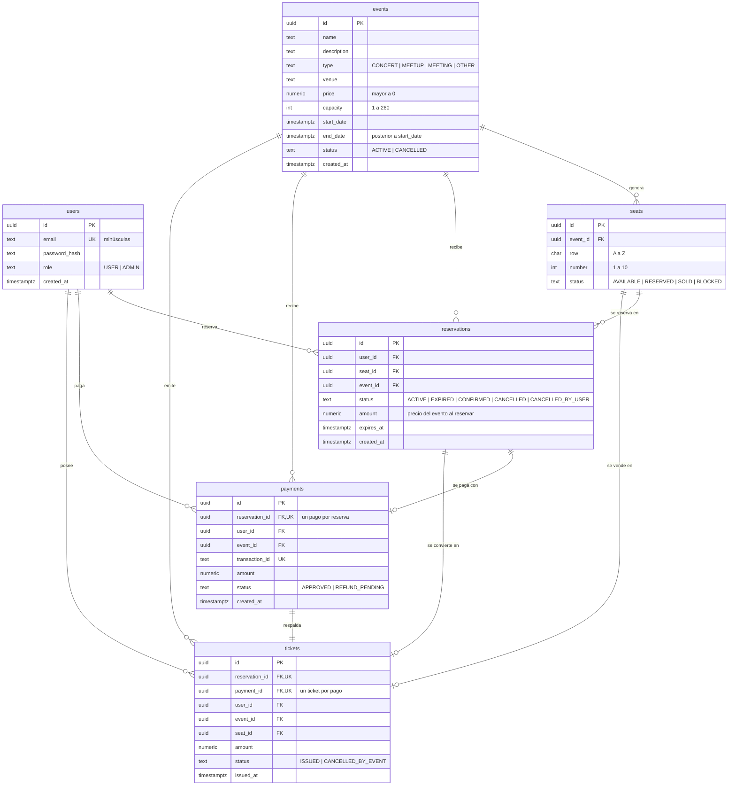
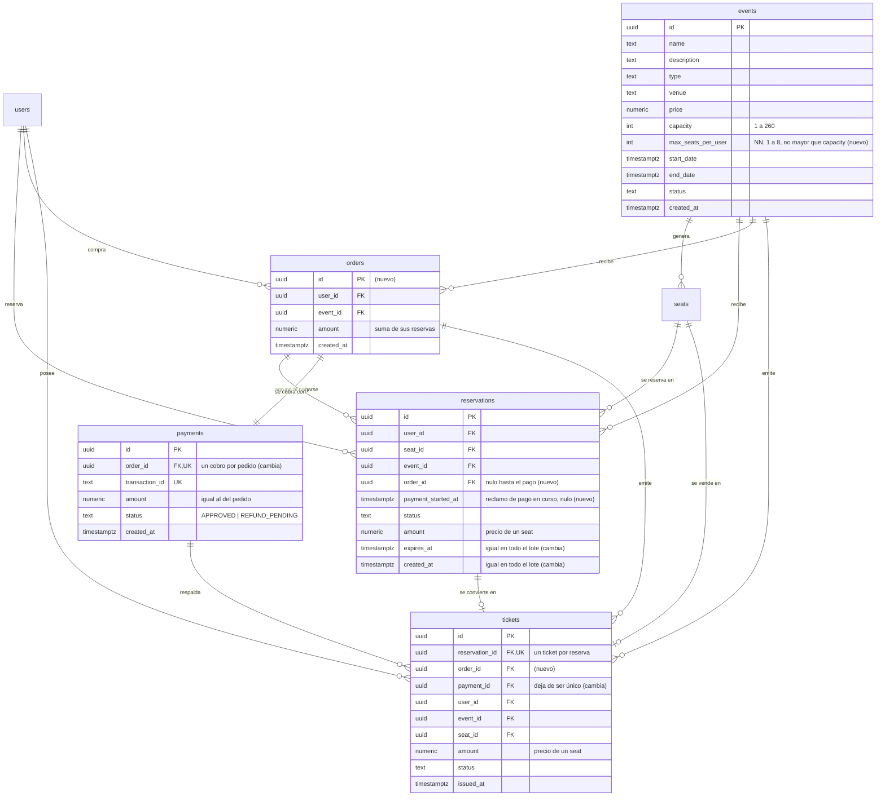

# ticket-api – Modelo de datos (entidad-relación)

Este documento describe el modelo de la **versión actual** (migraciones `001` a `006`) y el **modelo propuesto** por los cambios `event-seat-limit`, `seat-limit-enforcement` y `group-purchase`. El modelo propuesto aún no está implementado: se confirma al aprobar esos cambios.

Notación: `PK` clave primaria, `FK` clave foránea, `UK` única, `NN` no nula. Las marcas **(nuevo)** y **(cambia)** señalan las diferencias con la versión actual.

## 1. Modelo actual

### Cómo funciona hoy
- **Una reserva = un seat = un pago = un ticket.** Las relaciones `reservations`–`payments`–`tickets` son 1 a 1 por claves únicas.
- Un seat tiene como máximo una reserva `ACTIVE` (índice único parcial `reservations_seat_active_key`).
- **No existe ningún límite** de reservas por usuario ni por evento.
- Un `payments` en `REFUND_PENDING` es un cobro aprobado cuyo ticket no se pudo emitir (el evento se canceló durante el pago).
- `payments` solo guarda cobros aprobados por la pasarela; nunca datos de tarjeta.

## 2. Modelo propuesto

Las tablas `users` y `seats` no cambian y se omiten los atributos que no cambian en `events`, `reservations` (salvo los marcados) y `tickets`.

### Qué cambia

| Tabla | Cambio | Cambio OpenSpec |
|---|---|---|
| `events` | Columna `max_seats_per_user` (`NOT NULL`, `CHECK` 1 a 8, `CHECK` ≤ `capacity`), sin valor por defecto | `event-seat-limit` |
| `reservations` | Todas las de un lote se crean en una transacción y comparten `created_at` y `expires_at` (no hay tabla de lotes) | `seat-limit-enforcement` |
| `reservations` | Columna `order_id` (FK nula): se llena cuando la reserva entra a un pedido | `group-purchase` |
| `reservations` | Columna `payment_started_at` (nula): reclamo atómico mientras se cobra, para evitar el doble cobro; vence a los `PAYMENT_CLAIM_SECONDS` | `group-purchase` |
| `reservations` | Índices nuevos para los conteos del límite (ver abajo) | `seat-limit-enforcement` |
| `orders` | **Tabla nueva**: un pedido por compra, con el monto total | `group-purchase` |
| `payments` | `reservation_id`, `user_id` y `event_id` se reemplazan por `order_id` (único): un cobro por pedido. Estados sin cambio | `group-purchase` |
| `tickets` | Agrega `order_id`; `payment_id` deja de ser único (varios tickets por pago). `reservation_id` sigue único | `group-purchase` |

### Reglas de negocio y dónde se aplican

| Regla | Dónde vive |
|---|---|
| `maxSeatsPerUser` entre 1 y 8 y no mayor que la capacidad | Base de datos (`CHECK`) y validación de la API |
| Límite por evento: reservas `ACTIVE` vigentes + `CONFIRMED` del usuario en ese evento + las solicitadas ≤ `max_seats_per_user` | Servicio, en la transacción, con un bloqueo por usuario antes de contar. **No se puede expresar como restricción** |
| Tope global: reservas `ACTIVE` vigentes del usuario, de todos los eventos, + las solicitadas ≤ `MAX_ACTIVE_HOLDS_PER_USER` (8 por defecto) | Servicio, igual que el anterior; el valor está en la configuración |
| Un seat tiene a lo sumo una reserva `ACTIVE` | Base de datos (índice único parcial, sin cambio) |
| Un lote es todo o nada y comparte vencimiento | Servicio (una transacción) |
| Un pedido cubre reservas del mismo usuario y del mismo evento, todas `ACTIVE` y vigentes al cobrar | Servicio |
| Una reserva no se cobra dos veces a la vez: se reclama (`payment_started_at`) antes de llamar a la pasarela; si ya está reclamada, `PAYMENT_IN_PROGRESS`; si el reclamo falla por otra causa (evento o reserva cancelados, reserva vencida), se informa esa causa | Servicio (actualización atómica) y configuración (`PAYMENT_CLAIM_SECONDS` > tiempo límite de la pasarela) |
| Un cobro por pedido; un ticket por reserva | Base de datos (`payments.order_id` y `tickets.reservation_id` únicos) |
| `orders.amount` = suma de `reservations.amount` de sus reservas | Servicio (el cliente nunca envía el monto) |
| Si el evento se cancela con el cobro aprobado: no hay tickets y el pago queda `REFUND_PENDING` una sola vez por pedido | Servicio |

### Índices nuevos propuestos en `reservations`
- `(user_id, event_id)` parcial sobre `ACTIVE` y `CONFIRMED`: conteo del límite por evento.
- `(user_id)` parcial sobre `ACTIVE`: conteo del tope global.
- `(order_id)`: búsqueda de las reservas de un pedido (detección de compras duplicadas).

### Notas de migración
- La base de datos **se recrea** (`docker compose down -v`): no hay migración de datos; se editan las migraciones existentes.
- `reservations.order_id` apunta a `orders`, que se crea en la migración `005`: la columna se agrega ahí con `ALTER TABLE ... ADD COLUMN`, sin reordenar ni renumerar las migraciones (`orders` no depende de `reservations`).
- La migración `006` (estado `CANCELLED_BY_USER`) puede integrarse en `004` al recrear la base.
- `payments` conserva el estado `REFUND_PENDING`; no hay reembolsos en esta versión.
